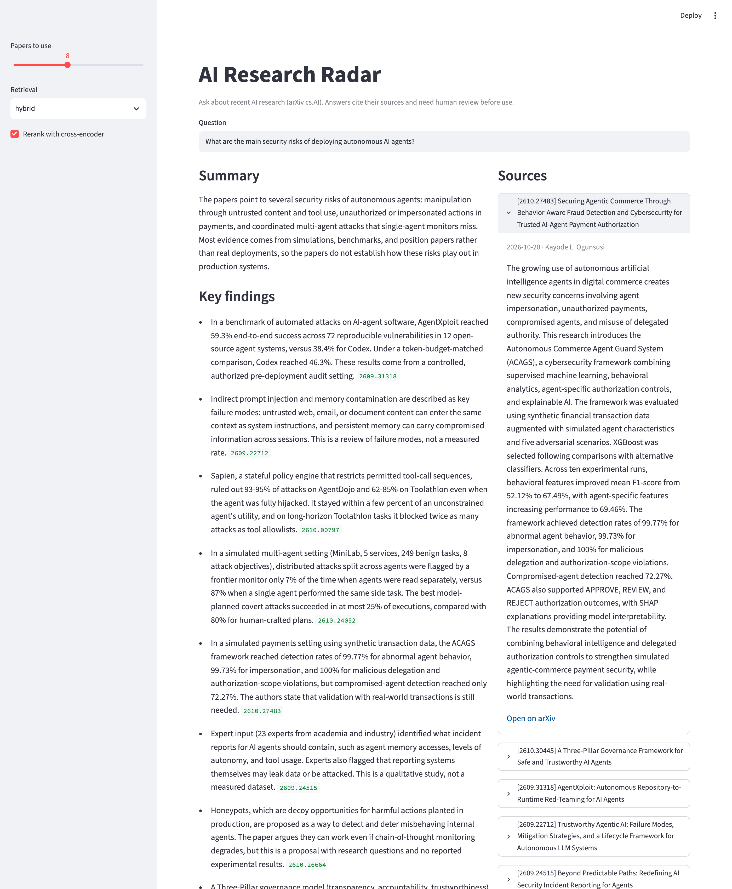

# AI Research Radar

**Ask a question about AI. Get a short, cited, plain-language brief built from the latest arXiv research.**

Hundreds of AI papers are posted to arXiv every day, far more than anyone can read. AI Research Radar
searches recent papers for the ones relevant to your question, then explains what they found, why it
matters, how mature it is and what the risks are. Every claim cites the paper it came from, and the
system checks that those citations are real.



Briefs can be shared as links: `http://localhost:8501/?q=your+question` opens with the question filled in.

## How it works

```
question
   │
   ▼
RETRIEVE (src/retrieve.py) ─────────────────────────────────────────────────────────────
   dense search    bge-small embeddings, cosine similarity      finds paraphrases
   keyword search  BM25                                         finds exact terms ("LoRA")
   fuse            Reciprocal Rank Fusion of both top-100 lists
   rerank          cross-encoder rescores the top 50            reads question + paper together
   │
   ▼  top 8 papers (title + abstract)
GENERATE (src/generate.py) ─────────────────────────────────────────────────────────────
   LLM writes a structured brief (Pydantic schema): summary, key findings, why it matters,
   maturity, risks. Rule: use only the papers given, cite an arXiv ID for every claim.
   │
   ▼
CHECK
   every cited ID must be one of the retrieved papers; anything else is flagged in the UI
```

| Step | File | What it does |
|---|---|---|
| Ingest | [src/ingest.py](src/ingest.py) | Downloads recent cs.AI papers (title, abstract, metadata) from the arXiv API |
| Index | [src/index.py](src/index.py) | Embeds every paper with a sentence-transformer and saves the vectors |
| Retrieve | [src/retrieve.py](src/retrieve.py) | Dense + BM25 hybrid search, then cross-encoder reranking |
| Generate | [src/generate.py](src/generate.py) | Structured, cited brief from Claude or Gemini (one setting in `.env`) |
| Evaluate retrieval | [src/evaluate.py](src/evaluate.py) | Recall@k and MRR for every retrieval configuration |
| Evaluate briefs | [src/evaluate_briefs.py](src/evaluate_briefs.py) | Citation validity, claim-level faithfulness, usefulness |
| App | [app.py](app.py) | Streamlit UI with sources and a downloadable brief |

## Results

**Retrieval**, 40 test questions, each with a known correct paper ([full table](docs/results.md)):

| Configuration | Recall@1 | Recall@5 | MRR |
|---|---|---|---|
| Keyword search (BM25) | 0.42 | 0.55 | 0.49 |
| Embeddings (bge-small) | 0.65 | 0.88 | 0.75 |
| **Hybrid + reranker (final)** | **0.75** | **0.88** | **0.80** |

The reranker is the biggest single improvement, and the better embedding model beats the weaker one by
0.18 Recall@1 with no other change.

**Brief quality**, 15 questions, about 190 claims each run. Claude Opus 5.5 fact-checks every claim
against only the abstracts it cites. Claude Haiku 5.5 writes the briefs.

| Prompt | Citation validity | Faithfulness | Faithfulness of implications | Usefulness (1–5) |
|---|---|---|---|---|
| v1 (original) | 100% | 85% | 71% | 4.0 |
| **v2 (+ faithfulness rules)** | **100%** | **92%** | **84%** | **4.1** |

The first version of this evaluation let the writer grade itself and reported 98%. A stronger judge
from a different model family dropped that to 73%, and showed the overclaiming was concentrated in the
"why it matters" implications. Four prompt rules targeting those failure patterns cut
partially-supported claims in half without making the briefs less useful
([v1 results](docs/brief_results_v1.md), [v2 results](docs/brief_results_v2.md)).

How each number is measured, and its caveats: [docs/EVALUATION.md](docs/EVALUATION.md).
How the project was built, step by step: [docs/BUILD_LOG.md](docs/BUILD_LOG.md).

## Run it

Needs Python 3.12 and [uv](https://docs.astral.sh/uv/), plus an LLM key: an
[Anthropic API key](https://console.anthropic.com) (the setup used for the results), or a free Gemini key
from [Google AI Studio](https://aistudio.google.com) with `LLM_PROVIDER=gemini`.

```bash
uv venv -p 3.12 .venv && uv pip install -p .venv/bin/python -r requirements.txt
cp .env.example .env                    # paste your ANTHROPIC_API_KEY (or GEMINI_API_KEY)
.venv/bin/python -m src.ingest          # ~5 min: 10,000 recent papers, 18 MB
.venv/bin/python -m src.index           # ~3 min on a laptop CPU
.venv/bin/streamlit run app.py          # opens http://localhost:8501
```

Run the tests (no models or API keys needed) and re-run the evaluations:

```bash
.venv/bin/python -m tests.test_core     # unit checks
.venv/bin/python -m src.evaluate        # retrieval  -> docs/results.md
.venv/bin/python -m src.evaluate_briefs --prompt v1   # briefs -> docs/brief_results_v1.md
.venv/bin/python -m src.evaluate_briefs --prompt v2   #        -> docs/brief_results_v2.md
```

## Project layout

```
├── app.py                    Streamlit UI
├── src/
│   ├── ingest.py             arXiv API -> data/papers.jsonl
│   ├── index.py              embeddings -> data/emb_*.npy
│   ├── retrieve.py           hybrid search + reranking
│   ├── generate.py           LLM brief (Gemini or Claude) + citation check
│   ├── evaluate.py           retrieval benchmark
│   └── evaluate_briefs.py    brief-quality benchmark
├── eval/
│   ├── benchmark.jsonl       40 retrieval test questions with the correct paper
│   ├── brief_questions.jsonl 15 open questions for brief quality
│   └── briefs/v1, v2/        every generated brief + judge verdict, for human review
├── tests/test_core.py        checks for citation validation, rank fusion and scoring
└── docs/
    ├── BUILD_LOG.md          what was built, in order, and the problems hit along the way
    ├── EVALUATION.md         how each metric is measured and its limitations
    ├── results.md            retrieval results (generated)
    └── brief_results_v*.md   brief results per prompt version (generated)
```

## Design choices

- **No LangChain or LlamaIndex.** The whole pipeline is about 400 lines of plain Python, so every step can be read and explained.
- **No vector database.** 10,000 vectors × 384 numbers is one matrix multiply that takes milliseconds. FAISS or Chroma would only pay off past a few hundred thousand papers.
- **Structured output.** The LLM fills a Pydantic schema instead of free text, so the UI, the citation check and the evaluator all read the same fields.
- **Measured, not assumed.** Each retrieval stage can be switched off, so the benchmark shows what it adds.

## Limitations

- Uses titles and abstracts, not full paper text, so briefs reflect what authors claim in their abstracts.
- Covers one arXiv category (cs.AI) over about six weeks (Sep 10 – Oct 26, 2026). Run `src.ingest` again to refresh.
- Briefs are drafts to read critically. At 92% faithfulness, some claims still overstate their sources.
- The v2 prompt rules were tuned on the same 15 questions they were measured on; a fresh question set is the next check.
- Gemini's free tier allows about 20 requests per model per day, so the evaluation runs on Claude.

## Roadmap

- Hosted demo
- Confirm the v2 prompt gain on new questions
- Full-text retrieval for the top papers
- Scheduled weekly digest of new papers on topics you follow

## License

MIT. See [LICENSE](LICENSE).
